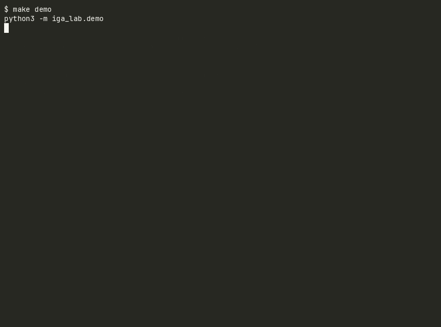
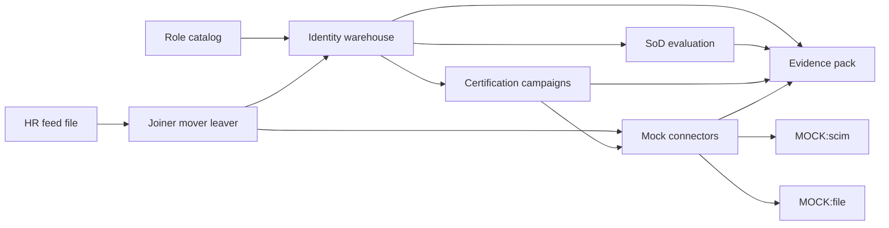

# iga-lab

This is a personal lab project. It uses synthetic data only. It is not a commercial IGA product and it is not affiliated with any employer. The evidence pack is not SOX compliance. It is practice for SOX-style access-control evidence.

The lab is a small Python model of workforce identity governance: an identity warehouse, a role catalog, joiner mover and leaver from an HR file, access certification, separation of duties, and mock provisioning. Nothing here connects to a live directory or a real workforce.

## Demo



The GIF is a real terminal recording of `make demo`.

## Quickstart

```bash
python3 -m venv .venv
source .venv/bin/activate
python -m pip install -e ".[dev]"
make test
IGA_DEMO_PACE=0 make demo
```

`make demo` writes:

- `reports/evidence.json`
- `reports/evidence.md`
- `reports/evidence.html`
- `var/filedrop/` pipe-delimited files for `MOCK:file`
- a local `MOCK:scim` service that the demo starts and stops

Open `reports/evidence.html` in a browser. The lab clock is fixed at 2026-02-20T15:00:00Z so the evidence pack is the same on every run. When stdout is a terminal, the demo pauses between sections so it can be watched. `IGA_DEMO_PACE=0` skips those pauses. `IGA_DEMO_PACE=1` forces them.

## Architecture



See [docs/architecture.md](docs/architecture.md) for the component notes and how this lab relates to commercial IGA, workforce IAM, and CIAM as categories.

## Feature tour

1. Seed data in `data/` has 50 synthetic employees and contractors, five applications, an orphaned wiki account, and conflicting ledger access.
2. `data/roles.yaml` defines birthright roles, including mailbox access for every active person, and requestable roles such as finance approver and vault operator.
3. `data/hr_events.yaml` is a thin joiner, mover, and leaver feed. It updates the warehouse and the mock connectors. There is no approval screen.
4. `MOCK:scim` is a local SCIM-like HTTP service. `MOCK:file` writes one pipe-delimited file per application. Both labels are on the app record and on the payload.
5. The manager campaign and the wiki application-owner campaign record approve and revoke decisions with the reviewer id. Revoked access is removed through the connector. `unreviewed` rows become missed reviews and stay provisioned.
6. `data/sod_policies.yaml` and `data/sod_exceptions.yaml` drive the violations report. An exception counts only when it is active, matches the person and policy, and has not expired.
7. The evidence pack records current access, campaign decisions, provisioning results, SoD exceptions, and timestamps.
8. `make test` covers happy paths and failure paths. The CI workflow runs lint, tests, and `make demo`, and uploads the HTML, Markdown, and JSON report.

## Layout

- `src/iga_lab/` library and demo
- `data/` synthetic seed
- `tests/` pytest suite
- `docs/architecture.md` design notes
- `reports/` generated evidence, not committed

## Out of scope

Live tenants, real credentials, an approval user interface, and production connectors are out of scope. This repository does not govern real people.
