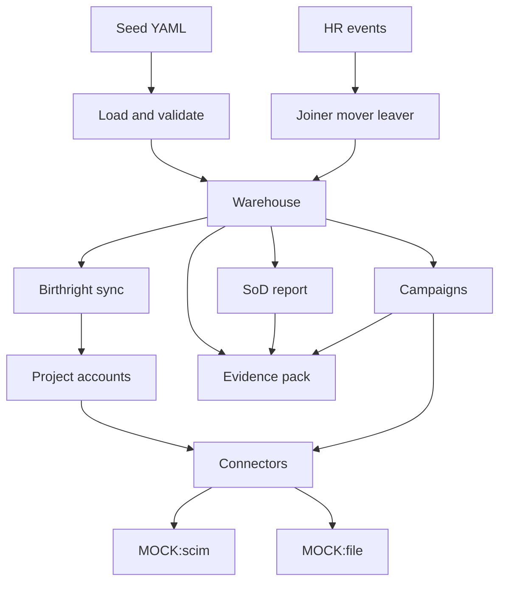

# Architecture

This is a personal lab project. It uses synthetic data only. It is not a commercial IGA product and it is not affiliated with any employer. The evidence pack is not SOX compliance. It is practice for SOX-style access-control evidence.

## Components

| Piece | Role |
| --- | --- |
| Identity warehouse | People, applications, accounts, roles, and assignments in memory |
| Role catalog | Birthright rules and requestable roles, stored in YAML |
| HR feed | Joiner, mover, and leaver events with no approval step |
| `MOCK:scim` | Local HTTP service with a small SCIM-like user API |
| `MOCK:file` | One pipe-delimited file per application |
| Campaigns | Manager review and application-owner review |
| SoD | Policy evaluation plus an exception path |
| Evidence pack | JSON, Markdown, and a self-contained HTML report |

## Identity warehouse

A person is an employee or a contractor, active or terminated, with a department, a title, and an optional manager. An application has an owner and a connector label. An account belongs to one application. Role-backed accounts are rebuilt from assignments. Orphan accounts have no person id and are left in place until a campaign revokes them.

The seed includes one orphaned wiki account, `orphan.wiki.legacy`, and one disabled legacy mailbox for a person who is already terminated.

## Role catalog

Birthright roles use a population rule:

- `all_active` grants the role to every active person. Staff email and wiki reader work this way.
- `department` grants the role when the department matches. Engineering receives wiki editor. Finance receives ledger read.

Requestable roles are listed in `data/assignments.yaml`. Examples are finance approver, finance clerk, and vault operator. Birthright assignments are not hand-listed. The sync step adds and removes them when HR data changes.

A certification can remove a birthright assignment. The next HR sync for that population will grant it again if the rule still matches. The demo runs certification after the HR feed and does not sync birthright again, so those revokes stay in place for the evidence pack.

## Joiner, mover, leaver

The feed is a YAML file. Each event has an id and an effective date.

- Joiner inserts an active person and grants birthright roles, then provisions accounts.
- Mover updates department, title, manager, email, or person type, then recomputes birthright. The seeded mover leaves engineering for finance, so wiki editor is removed and ledger read is added.
- Leaver marks the person terminated, removes every role, and disables accounts on the connectors.

Invalid events fail closed: unknown people, a second leaver, a duplicate event id, a duplicate person, and a joiner missing required fields all raise errors and do not invent access.

## Connectors

Application records say `MOCK:scim` or `MOCK:file`. The router refuses any other label.

`MOCK:scim` is a process-local HTTP service. Users carry `mockTarget: MOCK:scim`, a username, an active flag, and the entitlement list. Provisioning creates or replaces a user. Revocation sets `active` to false and clears entitlements, or removes a single entitlement when other access remains.

`MOCK:file` writes `var/filedrop/<app_id>.csv`. The delimiter is `|`. A column named `mock_target` is always `MOCK:file`. The folder also contains a short readme that labels the drop as a synthetic target.

A failed write is recorded as a provisioning result with `success: false`. Other applications are still attempted. The failed account stays dirty so a later publish can retry it.

## Certification campaigns

The manager campaign builds one item per current role assignment of an active person. The reviewer is the manager. People with no manager are reviewed by the fallback reviewer in the campaign file. That fallback reviewer is reviewed by the alternate, so nobody reviews only themselves by default.

The application-owner campaign builds one item per active entitlement on one application, including orphan accounts. The reviewer is the application owner stored on the app.

Decision files contain:

- `default_decision: approve` for the reviewed remainder
- `overrides` for explicit approve or revoke rows, each with `reviewer_id`
- `unreviewed` rows that stay pending

On close, pending items become `missed`. They are not deprovisioned. Revoke items remove the role, or remove the entitlement and any role that grants it, then publish to the connector. `decided_by` stores the reviewer identity and `decided_at` stores the lab-clock time. A decision from anyone other than the assigned reviewer is rejected. Decisions after close are rejected.

The seeded missed reviews are the requestable wiki editor role for one contractor in the manager campaign, and wiki reader for one people-ops account in the application-owner campaign.

## Separation of duties

Policies name two entitlements that one person must not hold together. Evaluation uses the union of active account entitlements and role grants.

The exception path is deliberate:

- status must be `active`
- the person must currently hold both sides of that policy
- `expires_at` must still be in the future on the lab clock

Anything else is reported and does not suppress the violation. The seed has a current exception for one finance person and an old exception, still marked active in the file, whose expiry is in the past. The old record does not clear the open violation. The manager campaign then revokes the conflicting approver role, and the later SoD snapshot shows that violation cleared. A payroll conflict that nobody revokes stays open. Approval of access is not the same thing as a clean SoD result.

## Evidence pack

`reports/evidence.json` is the machine-readable pack. `reports/evidence.md` and `reports/evidence.html` present the same facts: population, current access, both campaigns and every decision, joiner mover leaver summaries, every provisioning result, SoD policy, violations before and after certification, exception assessments, and timestamps. The HTML file uses no remote assets. The lab clock, not the wall clock, stamps the run so a repeated demo matches.

## How this relates to commercial IGA platforms

Commercial identity governance and administration (IGA) platforms, and the workforce IAM suites around them, usually combine the categories this lab practices at a very small scale:

- an identity warehouse reconciled from HR
- a role model with birthright access and requestable access
- joiner, mover, and leaver lifecycle
- connectors that provision and revoke accounts
- manager and application-owner certification
- separation of duties with an exception process
- evidence an auditor can read

Customer identity and access management (CIAM) is a neighboring category aimed at customers and other external identities. This lab does not try to cover CIAM.

A commercial platform also has to do things this repository leaves out: a review user interface, escalation, role mining, live directory connectors, high availability, and operational support. Use that kind of platform when real people are involved. Use this lab to practice the control flow with synthetic people.

Nothing in the evidence pack is an attestation or a completed control test.

## Out of scope

There is no live tenant, no real credential, and no production connector. The HR feed does not wait for approval. Birthright is a rule, not a mined role model.
